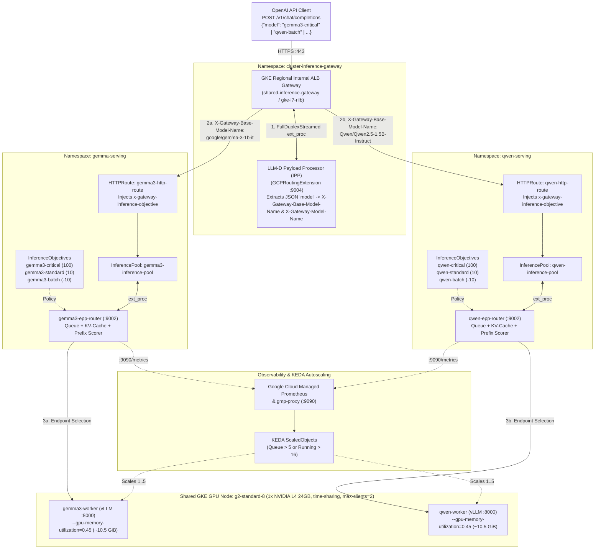

# Multi-Model & Multi-Tenant LLM Inference on GKE with Shared GPUs

A production reference architecture for running **multi-model, multi-tenant LLM inference on Google Kubernetes Engine (GKE)** using **GKE GPU Time-Sharing**, the **Kubernetes Gateway API Inference Extension (`llm-d`)**, **vLLM**, and **KEDA** autoscaling backed by **Google Cloud Managed Service for Prometheus (GMP)**.

This repository demonstrates how to co-host **`google/gemma-3-1b-it`** and **`Qwen/Qwen2.5-1.5B-Instruct`** on a **single shared `g2-standard-8` (1x NVIDIA L4 24 GB) GPU node**, cutting baseline GPU hardware costs by **50%** while providing:
- **Payload-Aware OpenAI Routing (Zero Custom Client Headers):** Clients send standard `POST /v1/chat/completions` requests with `"model"` in the JSON body; the Envoy `GCPRoutingExtension` (`llm-d-inference-payload-processor`) extracts the model and routes dynamically.
- **Multi-Tenant Priority Tiers & Load Shedding (`InferenceObjective`):** Built-in QoS tiers (`critical`, `standard`, `batch`) per model pool that protect high-priority interactive traffic by shedding negative-priority batch traffic (`HTTP 429`) when GPU KV-cache utilization saturates.
- **KV-Cache & Prefix-Aware Pod Scheduling (`InferencePool` & EPP Router):** Routes requests based on real-time vLLM KV-cache utilization (`vllm:gpu_cache_usage_perc`), waiting queue depth, and prefix-cache affinity rather than naive round-robin.
- **Scale-from-1 Autoscaling with KEDA + GMP:** Scales each model deployment (`1` to `5` replicas) independently using live EPP queue and running-stream metrics from Google Cloud Monitoring.

---

## Architecture Overview



---

## Repository Structure

| File | Description |
| :--- | :--- |
| [`gateway.yaml`](gateway.yaml) | Shared Regional Internal Gateway (`gke-l7-rilb`), LLM-D Inference Payload Processor (`payload-processor`), `GCPRoutingExtension`, and gRPC `HealthCheckPolicy`. |
| [`gemma-deployment.yaml`](gemma-deployment.yaml) | Gemma 3 (`google/gemma-3-1b-it`) vLLM worker (`0.45` VRAM cap), IPP model-mapping `ConfigMap`, EPP Router, `InferencePool`, `InferenceObjective`s (`100`, `10`, `-10`), `HTTPRoute`, and `PodMonitoring`. |
| [`qwen-deployment.yaml`](qwen-deployment.yaml) | Qwen 2.5 (`Qwen/Qwen2.5-1.5B-Instruct`) vLLM worker (`0.45` VRAM cap), IPP model-mapping `ConfigMap`, EPP Router, `InferencePool`, `InferenceObjective`s (`100`, `10`, `-10`), `HTTPRoute`, and `PodMonitoring`. |
| [`gemma-keda-setup.yaml`](gemma-keda-setup.yaml) | KEDA `ScaledObject` & HPA (`1`–`5` replicas) for `gemma3-worker` driven by EPP queue depth and active running streams. |
| [`qwen-keda-setup.yaml`](qwen-keda-setup.yaml) | KEDA `ScaledObject` & HPA (`1`–`5` replicas) for `qwen-worker` driven by EPP queue depth and active running streams. |
| [`gmp-proxy.yaml`](gmp-proxy.yaml) | In-cluster Google Cloud Managed Prometheus (`gmp-proxy`) frontend used by KEDA to execute PromQL queries against Cloud Monitoring via Workload Identity. |
| [`test-harness.sh`](test-harness.sh) | End-to-end validation and stress-test script verifying GPU time-sharing co-location, payload-aware routing, priority tiers, and concurrent multi-model execution. |
| [`architecture.md`](architecture.md) | Deep-dive architectural documentation covering data-plane flow, GPU memory partitioning, priority shedding, and scaling mechanics. |
| [`gke_cluster.md`](gke_cluster.md) | Reference summary of the GKE cluster topology, node pools, and installed controllers. |

---

## How Multi-Model & Multi-Tenant Routing Works

Clients always send standard OpenAI Chat Completions requests to `https://<GATEWAY_IP>/v1/chat/completions`—no custom HTTP headers are required. What you pass in the JSON `"model"` field determines both **which model pool** handles the request and **which priority tier (`InferenceObjective`)** is applied:

| JSON `"model"` Value in Request Body | Target Base Model (`InferencePool`) | Mapped `InferenceObjective` | Priority | Behavior Under GPU Saturation |
| :--- | :--- | :--- | :---: | :--- |
| `"gemma3-critical"` | `google/gemma-3-1b-it` | `gemma3-critical` | **`100`** | Highest priority; protected from load shedding. |
| `"google/gemma-3-1b-it"` or `"gemma3-standard"` | `google/gemma-3-1b-it` | `gemma3-standard` | **`10`** | Default production tier; queued behind `critical`. |
| `"gemma3-batch"` | `google/gemma-3-1b-it` | `gemma3-batch` | **`-10`** | **Sheddable (`< 0`):** Dropped (`HTTP 429`) when pool KV-cache saturates ($\ge 80\%$). |
| `"qwen-critical"` | `Qwen/Qwen2.5-1.5B-Instruct` | `qwen-critical` | **`100`** | Highest priority; protected from load shedding. |
| `"Qwen/Qwen2.5-1.5B-Instruct"` or `"qwen-standard"` | `Qwen/Qwen2.5-1.5B-Instruct` | `qwen-standard` | **`10`** | Default production tier; queued behind `critical`. |
| `"qwen-batch"` | `Qwen/Qwen2.5-1.5B-Instruct` | `qwen-batch` | **`-10`** | **Sheddable (`< 0`):** Dropped (`HTTP 429`) when pool KV-cache saturates ($\ge 80\%$). |

---

## Prerequisites

1. **GKE Standard Cluster (1.32+ / 1.34+)** with:
   - **GKE Gateway Controller** enabled (`gke-l7-rilb`) and a regional **proxy-only subnet** (`--purpose=REGIONAL_MANAGED_PROXY --role=ACTIVE`) in the cluster region.
   - **Google Cloud Managed Service for Prometheus (GMP)** enabled (`--enable-managed-prometheus`).
   - **Workload Identity** enabled (`--workload-pool=<PROJECT_ID>.svc.id.goog`).
   - **G2 GPU Node Pool (or Node Auto-Provisioning)** configured with `g2-standard-8` (`1x nvidia-l4`), GPU time-sharing (`--gpu-sharing-strategy=time-sharing`, `--max-shared-clients-per-gpu=2`), and default GPU drivers.
2. **Gateway API Inference Extension CRDs (`v1.0.1`)**:
   ```bash
   kubectl apply -f https://github.com/kubernetes-sigs/gateway-api-inference-extension/releases/download/v1.0.1/manifests.yaml
   ```
3. **KEDA (`v2.15+`)** installed in the `keda` namespace:
   ```bash
   helm repo add kedacore https://kedacore.github.io/charts
   helm upgrade --install keda kedacore/keda --namespace keda --create-namespace
   ```

---

## Step-by-Step Deployment

### 1. Create Namespaces & Secrets

Create the model and gateway namespaces, the Hugging Face token secrets (required to pull gated models like `google/gemma-3-1b-it`), and a TLS certificate for the internal HTTPS Gateway:

```bash
export HF_TOKEN="hf_your_huggingface_token"
export PROJECT_ID="your-gcp-project-id"

kubectl create namespace cluster-inference-gateway --dry-run=client -o yaml | kubectl apply -f -
kubectl create namespace gemma-serving --dry-run=client -o yaml | kubectl apply -f -
kubectl create namespace qwen-serving --dry-run=client -o yaml | kubectl apply -f -

# Hugging Face secrets for vLLM workers
kubectl create secret generic hf-secret -n gemma-serving --from-literal=hf_token="${HF_TOKEN}" --dry-run=client -o yaml | kubectl apply -f -
kubectl create secret generic hf-secret -n qwen-serving --from-literal=hf_token="${HF_TOKEN}" --dry-run=client -o yaml | kubectl apply -f -

# Self-signed TLS certificate for the internal Gateway
openssl req -x509 -nodes -days 365 -newkey rsa:2048 \
  -keyout /tmp/tls.key -out /tmp/tls.crt \
  -subj "/CN=gemma.internal/O=inference"
kubectl create secret tls gemma-gateway-tls-cert \
  -n cluster-inference-gateway \
  --cert=/tmp/tls.crt --key=/tmp/tls.key \
  --dry-run=client -o yaml | kubectl apply -f -
rm -f /tmp/tls.key /tmp/tls.crt
```

### 2. Configure & Deploy the GMP PromQL Proxy

Update `YOUR_GCP_PROJECT_ID` in [`gmp-proxy.yaml`](gmp-proxy.yaml) (and bind the Kubernetes ServiceAccount `gmp-proxy/gmp-frontend-ksa` to a GCP Service Account with `roles/monitoring.viewer` via Workload Identity):

```bash
sed "s/YOUR_GCP_PROJECT_ID/${PROJECT_ID}/g" gmp-proxy.yaml | kubectl apply -f -
```

### 3. Deploy the Shared Gateway & Payload Processor

```bash
kubectl apply -f gateway.yaml
```

### 4. Deploy the Gemma 3 & Qwen 2.5 Inference Stacks

```bash
kubectl apply -f gemma-deployment.yaml
kubectl apply -f qwen-deployment.yaml
```

Both `gemma3-worker` and `qwen-worker` use cross-namespace `podAffinity` and GPU time-sharing `nodeSelector` labels (`cloud.google.com/gke-gpu-sharing-strategy: time-sharing`, `cloud.google.com/gke-max-shared-clients-per-gpu: "2"`) so Kubernetes schedules both models onto the **same `g2-standard-8` node**.

### 5. Apply KEDA Autoscalers

```bash
kubectl apply -f gemma-keda-setup.yaml
kubectl apply -f qwen-keda-setup.yaml
```

---

## Validation & Testing (`./test-harness.sh`)

Because `shared-inference-gateway` uses `gke-l7-rilb` (an internal VPC Load Balancer IP), [`test-harness.sh`](test-harness.sh) automatically executes its test requests from inside the cluster VPC via `kubectl exec` against the internal Gateway VIP—requiring no public internet exposure or manual VPN setup.

Run the test harness with no arguments:

```bash
./test-harness.sh
```

What [`test-harness.sh`](test-harness.sh) validates:
1. **Stage 1 — Shared GPU Time-Sharing:** Confirms `gemma3-worker` and `qwen-worker` run on the **exact same `g2-standard-8` node** and inspects live `nvidia-smi` memory isolation (`~10.5 GiB` / `45%` per container on the 23 GiB NVIDIA L4).
2. **Stage 2 — Control Plane & CRD Health:** Verifies the `Gateway`, `GCPRoutingExtension`, `InferencePool`s, `InferenceObjective`s, and KEDA `HPA`s.
3. **Stage 3 — Payload-Aware Multi-Model Routing:** Sends standard OpenAI `POST /v1/chat/completions` requests for `"google/gemma-3-1b-it"` and `"Qwen/Qwen2.5-1.5B-Instruct"` with no custom routing headers.
4. **Stage 4 — Multi-Tenant Priority Tiers:** Tests `"gemma3-critical"`, `"qwen-critical"`, `"gemma3-batch"`, and `"qwen-batch"`, and verifies header/body mutation in the `payload-processor` logs.
5. **Stage 5 — Concurrent Multi-Model GPU Stress Test & Telemetry:** Fires 8 parallel requests across both models simultaneously to verify concurrent time-shared execution on the single L4 GPU and scrapes `:8000/metrics` from both vLLM engines.
