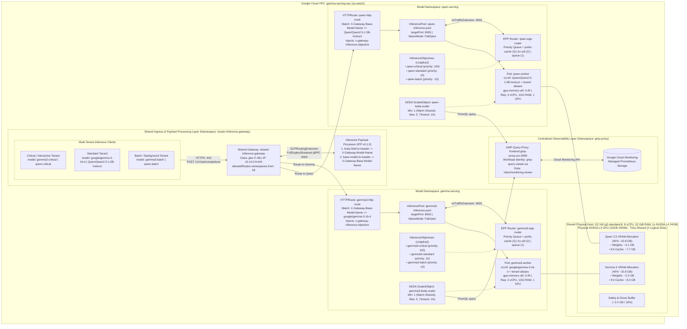

# Architecture Design & System Specification: Intelligent Multi-Model & Multi-Tenant GPU Inference Cluster on GKE Autopilot (Gemma 3 & Qwen 2.5 with LLM-D and GPU Time-Sharing)

## 1. Executive Summary

This architecture specification details the **intelligent multi-model and multi-tenant LLM serving infrastructure** on **Google Kubernetes Engine (GKE) Autopilot** using **G2 series machines (`g2-standard-8`)** powered by **NVIDIA L4 GPUs** (24 GB VRAM). The platform serves two distinct foundational small language models and six priority-differentiated tenant aliases behind a **single, unified OpenAI-compatible endpoint** (`https://10.10.0.9/v1/chat/completions`):

1. **Google Gemma 3 1B IT** (`google/gemma-3-1b-it`, plus tenant tiers `gemma3-critical`, `gemma3-standard`, `gemma3-batch`) in namespace `gemma-serving`
2. **Alibaba Qwen 2.5 1.5B Instruct** (`Qwen/Qwen2.5-1.5B-Instruct`, plus tenant tiers `qwen-critical`, `qwen-standard`, `qwen-batch`) in namespace `qwen-serving`

The design solves four core engineering challenges:
1. **Hardware Efficiency via GKE GPU Time-Sharing on G2 Nodes:** Because an NVIDIA L4 GPU does not support Multi-Instance GPU (MIG) and GKE Autopilot rejects NVIDIA MPS, both models are co-located on a single physical `g2-standard-8` L4 GPU using **GKE Autopilot GPU Time-Sharing** (`cloud.google.com/gke-gpu-sharing-strategy: time-sharing`, `cloud.google.com/gke-max-shared-clients-per-gpu: "2"`) with strictly budgeted VRAM (`--gpu-memory-utilization=0.45` each = ~10.8 GB per model), cross-namespace `podAffinity`, and a warm baseline (`minReplicaCount: 1` per model).
2. **Payload-Aware Multi-Model & Multi-Tenant Routing:** The platform deploys the **LLM-D Inference Payload Processor (IPP)** (`ghcr.io/llm-d/llm-d-inference-payload-processor:v0.1.0`) wired into the GKE Gateway via `GCPRoutingExtension` and `HealthCheckPolicy`. IPP runs two plugins in sequence:
   - `body-field-to-header`: Extracts the JSON `"model"` field into `X-Gateway-Model-Name`.
   - `base-model-to-header`: Watches `ipp-managed` `ConfigMap`s across all namespaces to resolve both base model names and tenant model aliases (`gemma3-critical`, `qwen-batch`, etc.) into `X-Gateway-Base-Model-Name`.
3. **Priority-Tiered Multi-Tenancy (`InferenceObjective` v1alpha2):** Each model pool defines three `InferenceObjective` priority tiers (`critical` at priority `100`, `standard` at `10`, and `batch` at `-10`). Tier-aware `HTTPRoute` rules automatically inject the `x-gateway-inference-objective` header based on `X-Gateway-Model-Name`, enabling the **LLM-D Endpoint Picker (EPP)** (`epp:v1.0.1`) to prioritize interactive tenant traffic ahead of batch workloads and shed low-priority load (`HTTP 429`) when GPU KV-cache or queue saturation thresholds are exceeded.
4. **Full-Stack Per-Model GPU Observability & Elastic Autoscaling:** Both EPP flow-control metrics (`:9090/metrics`) and direct vLLM engine metrics (`:8000/metrics` via `gemma3-vllm-monitoring` and `qwen-vllm-monitoring`) are scraped into Google Cloud Managed Service for Prometheus (GMP), powering KEDA autoscaling (`1 ↔ 5` replicas) and per-model KV-cache utilization tracking (`vllm:gpu_cache_usage_factor`).

---

## 2. Multi-Model & Multi-Tenant Architecture Diagram



---

## 3. Co-Locating Models on NVIDIA L4 (`g2-standard-8`) via GPU Time-Sharing

### 3.1 Hardware & Platform Constraints
- **No MIG Support:** The NVIDIA L4 GPU (Ada Lovelace architecture) lacks hardware Multi-Instance GPU (MIG) slicing.
- **Autopilot Rejection of MPS:** NVIDIA Multi-Process Service (`cloud.google.com/gke-gpu-sharing-strategy: mps`) is rejected by GKE Autopilot.
- **Supported Strategy:** **GKE GPU Time-Sharing** (`cloud.google.com/gke-gpu-sharing-strategy: time-sharing`), verified and mutated automatically by GKE Autopilot's Warden admission webhook.

### 3.2 Time-Sharing Configuration
Both `gemma3-worker` ([gemma-deployment.yaml](file:///home/rohitmishra/source/gemma-serving-gke/gemma-deployment.yaml)) and `qwen-worker` ([qwen-deployment.yaml](file:///home/rohitmishra/source/gemma-serving-gke/qwen-deployment.yaml)) configure identical time-sharing node selectors:

```yaml
nodeSelector:
  cloud.google.com/gke-accelerator: nvidia-l4
  cloud.google.com/gke-gpu-driver-version: default
  cloud.google.com/gke-gpu-sharing-strategy: time-sharing
  cloud.google.com/gke-max-shared-clients-per-gpu: "2"
```

- Each container requests `nvidia.com/gpu: "1"`, representing one logical time-sliced client slot.
- `gke-max-shared-clients-per-gpu: "2"` advertises `2` allocatable `nvidia.com/gpu` slots per physical L4 GPU on the `g2-standard-8` node.

### 3.3 Strict VRAM Budgeting & OOM Prevention
Because time-sharing shares a flat 24 GB physical address space without hardware memory fences, vLLM's memory allocation is strictly bounded in software:

$$\text{VRAM}_{\text{total}} = 24\,\text{GB}$$
$$\text{VRAM}_{\text{Gemma}} = 0.45 \times 24\,\text{GB} = 10.8\,\text{GB}$$
$$\text{VRAM}_{\text{Qwen}} = 0.45 \times 24\,\text{GB} = 10.8\,\text{GB}$$
$$\text{VRAM}_{\text{Buffer}} = 0.10 \times 24\,\text{GB} = 2.4\,\text{GB}\quad(\text{CUDA contexts, PyTorch workspace, driver})$$

| Component | Model Parameters | Precision | Weight Size | KV-Cache Budget | `--gpu-memory-utilization` |
|---|---|---|---|---|---|
| **Gemma 3 1B IT** | 1.0 Billion | `bfloat16` | ~2.5 GB | ~8.3 GB | `0.45` |
| **Qwen 2.5 1.5B Instruct** | 1.54 Billion | `bfloat16` | ~3.1 GB | ~7.7 GB | `0.45` |

### 3.4 Cross-Namespace Node Packing & Compute Sizing
To guarantee that both pods schedule onto the **exact same physical host** across their respective namespaces (`gemma-serving` and `qwen-serving`) rather than triggering two separate G2 VMs:
1. **Cross-Namespace `podAffinity`:**
   ```yaml
   affinity:
     podAffinity:
       preferredDuringSchedulingIgnoredDuringExecution:
       - weight: 100
         podAffinityTerm:
           namespaces:
           - gemma-serving
           - qwen-serving
           labelSelector:
             matchExpressions:
             - key: app
               operator: In
               values: ["gemma3-worker", "qwen-worker"]
           topologyKey: "kubernetes.io/hostname"
   ```
2. **CPU & Memory Sizing on `g2-standard-8`:**
   - `gemma3-worker`: 3 vCPU, 12 GiB RAM, 3 GiB `/dev/shm`
   - `qwen-worker`: 3 vCPU, 12 GiB RAM, 3 GiB `/dev/shm`
   - Total demand = 6 vCPU, 24 GiB RAM, 2 logical GPU slots on 1 physical L4, leaving ~2 vCPUs and ~8 GiB RAM for Autopilot system and driver daemonsets on a single **`g2-standard-8`** instance (8 vCPUs, 32 GiB RAM, 1x NVIDIA L4).

---

## 4. Ingress, Payload-Aware Multi-Model Routing & Multi-Tenant Priority Tiers

### 4.1 LLM-D Inference Payload Processor (IPP) & `GCPRoutingExtension`
Deployed in `cluster-inference-gateway` ([gateway.yaml](file:///home/rohitmishra/source/gemma-serving-gke/gateway.yaml)), the **Inference Payload Processor (IPP)** (`ghcr.io/llm-d/llm-d-inference-payload-processor:v0.1.0`) is attached to `shared-inference-gateway` via a `GCPRoutingExtension` (`FullDuplexStreamed` over gRPC port `9004`, health-checked via `HealthCheckPolicy` on gRPC port `9005`):

```yaml
apiVersion: llm-d.ai/v1alpha1
kind: PayloadProcessorConfig
plugins:
- type: body-field-to-header
  parameters:
    fieldName: model
    headerName: X-Gateway-Model-Name
- type: base-model-to-header
profiles:
- name: default
  plugins:
    request:
    - pluginRef: body-field-to-header
    - pluginRef: base-model-to-header
```

1. **`body-field-to-header`:** Reads `"model"` from the incoming JSON request body and injects `X-Gateway-Model-Name: <requested-model-or-alias>`.
2. **`base-model-to-header`:** Uses cluster-wide `ClusterRole` permissions (`payload-processor-configmap-reader`) to watch `ConfigMap`s labeled `inference.llm-d.ai/ipp-managed: "true"` in `gemma-serving` and `qwen-serving`, mapping both foundational model names and tenant tier aliases to `X-Gateway-Base-Model-Name`:

```yaml
# In gemma-serving (ConfigMap/gemma3-model-mapping):
data:
  baseModel: "google/gemma-3-1b-it"
  adapters: |
    - gemma3-critical
    - gemma3-standard
    - gemma3-batch
---
# In qwen-serving (ConfigMap/qwen-model-mapping):
data:
  baseModel: "Qwen/Qwen2.5-1.5B-Instruct"
  adapters: |
    - qwen-critical
    - qwen-standard
    - qwen-batch
```

### 4.2 Priority-Tiered Multi-Tenancy with `InferenceObjective` (`v1alpha2`)
Each model namespace defines three `InferenceObjective` (`inference.networking.x-k8s.io/v1alpha2`) resources bound to its `InferencePool`:

| Tenant Tier | Gemma 3 Objective / Model Alias | Qwen 2.5 Objective / Model Alias | `spec.priority` | Scheduling & Saturation Behavior in EPP (`epp:v1.0.1`) |
| :--- | :--- | :--- | :--- | :--- |
| **Critical / Interactive** | `gemma3-critical` | `qwen-critical` | **`100`** | Dispatched first from EPP flow-control queue; protected from load shedding during GPU saturation. |
| **Standard (Default)** | `gemma3-standard` (`google/gemma-3-1b-it`) | `qwen-standard` (`Qwen/Qwen2.5-1.5B-Instruct`) | **`10`** | Standard interactive priority tier; applied automatically when base model ID is requested. |
| **Batch / Background** | `gemma3-batch` | `qwen-batch` | **`-10`** | Lowest priority; shed first (`HTTP 429 Too Many Requests`) when `SaturationDetector` hits `queueDepthThreshold: 5` or `kvCacheUtilThreshold: 0.8`. |

### 4.3 Tier-Aware `HTTPRoute` Header Injection & vLLM Multi-Alias Serving
- **HTTPRoute Rules:** `gemma3-http-route` and `qwen-http-route` match `X-Gateway-Base-Model-Name` (to select the model pool) and `X-Gateway-Model-Name` (to detect the tenant tier), using `RequestHeaderModifier` filters to inject `x-gateway-inference-objective: <tier-objective-name>` before the request reaches the EPP router. Clients may also explicitly pass `-H "x-gateway-inference-objective: <tier>"` with the canonical base model name.
- **vLLM `--served-model-name`:** Both vLLM deployments register all aliases (`--served-model-name google/gemma-3-1b-it gemma3-critical gemma3-standard gemma3-batch` and `--served-model-name Qwen/Qwen2.5-1.5B-Instruct qwen-critical qwen-standard qwen-batch`) so the OpenAI server accepts the tenant alias directly without payload mutation.

---

## 5. Observability & Warm Baseline KEDA Autoscaling

### 5.1 Dual-Layer Prometheus Telemetry (EPP + Direct vLLM Engine)
Because GKE Autopilot suppresses container-level `kubernetes.io/container/accelerator/*` metrics on time-shared GPUs, each namespace deploys **two** `PodMonitoring` resources:
1. **EPP Router Telemetry (`gemma3-epp-monitoring` & `qwen-epp-monitoring`):** Scrapes `:9090/metrics` every `10s` for `llm_d_epp_flow_control_queue_size` and `llm_d_epp_request_running`.
2. **vLLM Engine Telemetry (`gemma3-vllm-monitoring` & `qwen-vllm-monitoring`):** Scrapes `:8000/metrics` (`port: http`) every `15s` for per-model GPU KV-cache utilization (`vllm:gpu_cache_usage_factor`), running requests (`vllm:num_requests_running`), waiting queue (`vllm:num_requests_waiting`), and TTFT/TPOT latency histograms.

### 5.2 Warm Shared Baseline Autoscaling (`1 ↔ 5` Replicas)
Both [gemma-keda-setup.yaml](file:///home/rohitmishra/source/gemma-serving-gke/gemma-keda-setup.yaml) (`gemma3-keda-scaler`) and [qwen-keda-setup.yaml](file:///home/rohitmishra/source/gemma-serving-gke/qwen-keda-setup.yaml) (`qwen-keda-scaler`) are configured with:
- **`minReplicaCount: 1` & `maxReplicaCount: 5`:** Keeps 1 warm replica of Gemma 3 and 1 warm replica of Qwen 2.5 co-located on a **single shared `g2-standard-8` node** at baseline (eliminating the 3–5 minute GKE Autopilot GPU cold-start deadlock), while scaling up horizontally (`1 -> 5`) under burst traffic.
- **`timeout: "10s"` & `ignoreNullValues: "true"`:** Prevents `context canceled` timeouts when KEDA queries Google Cloud Monitoring via `http://frontend.gmp-proxy.svc:9090`.
- **Triggers:**
  - `llm_d_epp_flow_control_queue_size` (`threshold: "5"`)
  - `llm_d_epp_request_running` (`threshold: "16"`)

---

## 6. Manifest Organization

```
├── gateway.yaml              # Shared Gateway, IPP Deployment/Service, HealthCheckPolicy & GCPRoutingExtension
├── gmp-proxy.yaml            # Shared Google Managed Prometheus Query Proxy in namespace gmp-proxy
├── gemma-deployment.yaml     # Gemma 3 worker, EPP, InferencePool, HealthCheckPolicy, InferenceObjectives, HTTPRoute & PodMonitorings
├── gemma-keda-setup.yaml     # Gemma 3 KEDA ScaledObject (min: 1, max: 5, timeout: 10s)
├── qwen-deployment.yaml      # Qwen 2.5 worker, EPP, InferencePool, HealthCheckPolicy, InferenceObjectives, HTTPRoute & PodMonitorings
└── qwen-keda-setup.yaml      # Qwen 2.5 KEDA ScaledObject (min: 1, max: 5, timeout: 10s)
```

---

## 7. Verification & Multi-Tenant Operational Commands

### 7.1 Verifying Shared GPU Placement & Control Plane Readiness
```bash
# Verify both worker pods share the exact same g2-standard-8 node via GPU time-sharing
kubectl get pods -A -l 'app in (gemma3-worker, qwen-worker)' \
  -o custom-columns=NAME:.metadata.name,NS:.metadata.namespace,NODE:.spec.nodeName,STATUS:.status.phase

# Check Gateway, GCPRoutingExtension, InferencePools, and InferenceObjectives
kubectl get gateway,gcproutingextension,healthcheckpolicy -n cluster-inference-gateway
kubectl get inferencepool,inferenceobjective,httproute -A
kubectl get scaledobject,hpa -A
```

### 7.2 End-to-End Multi-Model & Multi-Tenant Inference Testing (No Custom Headers Required)
```bash
# 1. Standard Gemma 3 Request (IPP extracts "model" -> routes to gemma3-inference-pool with gemma3-standard priority 10)
curl -k https://10.10.0.9/v1/chat/completions \
  -H "Host: gemma.internal" \
  -H "Content-Type: application/json" \
  -d '{
    "model": "google/gemma-3-1b-it",
    "messages": [{"role": "user", "content": "Explain KV-cache in one sentence."}]
  }'

# 2. Critical-Tier Qwen 2.5 Request (IPP + HTTPRoute assign qwen-critical InferenceObjective with priority 100)
curl -k https://10.10.0.9/v1/chat/completions \
  -H "Host: gemma.internal" \
  -H "Content-Type: application/json" \
  -d '{
    "model": "qwen-critical",
    "messages": [{"role": "user", "content": "Explain GPU time-sharing in one sentence."}]
  }'

# 3. Batch-Tier Gemma 3 Request (Assigned gemma3-batch InferenceObjective with priority -10; shed first on overload)
curl -k https://10.10.0.9/v1/chat/completions \
  -H "Host: gemma.internal" \
  -H "Content-Type: application/json" \
  -d '{
    "model": "gemma3-batch",
    "messages": [{"role": "user", "content": "Summarize batch scheduling."}]
  }'
```
